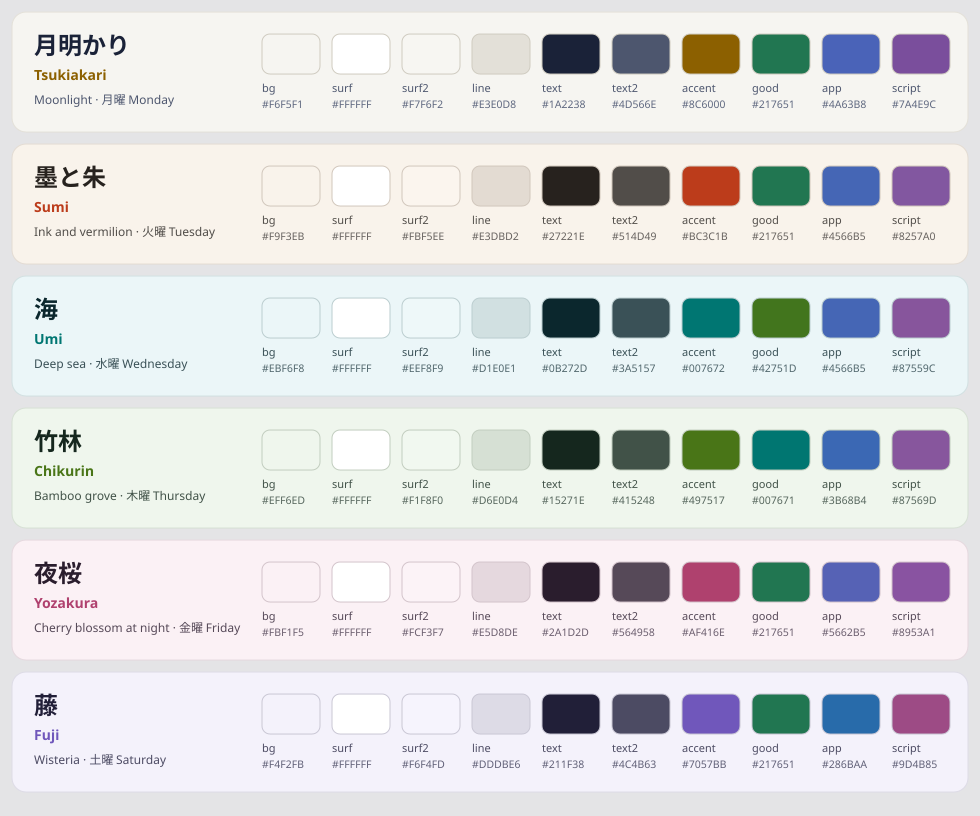

# Colour themes

One set of colours for my apps, slides and documents, so they look like they belong together and not like everything else.

Six themes, each named after a Japanese scene and each tied to a day of the week. Monday to Saturday take the element in the day's name (月 moon, 火 fire, 水 water, 木 wood) or its mood; Sunday rests. Every theme has a dark palette and a light palette.

Some apps also have a theme of their own, an **app theme**, made the same way (see [App themes](#app-themes)). The swatch sheets show the six weekday themes first, then the app themes.




| Day | Theme | Meaning | Colours | Why this day |
| --- | --- | --- | --- | --- |
| 月 Monday | 月明かり Tsukiakari | Moonlight | Navy and pale gold | 月曜 is the day of the moon |
| 火 Tuesday | 墨と朱 Sumi | Ink and vermilion | Warm charcoal and seal red | 火曜 is the day of fire |
| 水 Wednesday | 海 Umi | Deep sea | Blue-green black and aqua | 水曜 is the day of water |
| 木 Thursday | 竹林 Chikurin | Bamboo grove | Forest black and bamboo green | 木曜 is the day of wood |
| 金 Friday | 夜桜 Yozakura | Cherry blossom at night | Plum black and sakura pink | 花金, the flowery Friday night |
| 土 Saturday | 藤 Fuji | Wisteria | Violet black and wisteria purple | The quiet of the weekend |
| 日 Sunday | (rest) | | | No theme of its own: an app shows the base theme its owner chose |

The Colours column describes the dark palette. The light palette of a theme is the same scene in daylight:

| Theme | Light palette |
| --- | --- |
| 月明かり Tsukiakari | Warm paper, navy ink and deep gold |
| 墨と朱 Sumi | Washi paper, charcoal ink and seal red |
| 海 Umi | Sea-mist paper, deep-sea ink and teal |
| 竹林 Chikurin | Pale leaf paper, forest ink and bamboo green |
| 夜桜 Yozakura | Petal paper, plum ink and deep rose |
| 藤 Fuji | Wisteria-white paper, violet ink and wisteria purple |

## Dark and light

A light palette is not the dark one turned inside out. It is made in three moves:

1. **Ink.** The theme's dark background colour becomes the text.
2. **Paper.** The background is a very pale tint of the theme's hue, with pure white for cards (`surf`).
3. **Accent.** The same hue as the dark accent, made deeper until it can be read on the paper (the pale dark-mode accents are only 1.6:1 to 2.7:1 on white).

The primary button is the accent in dark and the ink in light. The data colours (`good`, `app`, `script`) and `warn` are deepened in the same way.

## App themes

An app theme is the default look of one app: it says "this is that app" at a glance. It has every role of a weekday theme, in dark and in light, and passes the same checks. The app can still offer the six weekday themes and "follow the weekday".

| Theme | App | Dark | Light | Why |
| --- | --- | --- | --- | --- |
| 帳場 Chōba (the counting desk) | 仕分け Shiwake | Dark wood, pale indigo ink, seal red | Kraft paper, white slips, indigo ink, seal red | Shiwake sorts paper slips at a desk; the red seal marks the slips a person must check |

Use an app theme only for its own app, and for slides or pages about that app. It is never the theme of the day.

An app theme is designed for one app at a time, when that app needs a look of its own. An app that fits a weekday theme well can simply use the weekday themes.

## What is here

| Path | What it is |
| --- | --- |
| `themes/tokens.json` | **The source of truth.** The six weekday themes (`themes`) and the app themes (`app_themes`): names, weekday or app, and colours by role under `dark` and `light`. |
| `themes/themes.css` | The same colours as CSS variables (`--ct-bg`, `--ct-accent`, ...), one block per theme and mode. Made by the build tool. |
| `colour_themes.py` | A small Python helper: `palette("umi")`, `palette("umi", mode="light")`, `theme_for_date(date.today())`, `app_theme_for("shiwake")`. |
| `preview/index.html` | Open in a browser to see every theme, dark and light, on a small app window. |
| `preview/themes.svg`, `preview/themes-light.svg` | The swatch sheets shown above. |
| `icons/<app>/` | One folder per app: `icon.svg` (the source), `png/` sizes 16 to 1024, and `icon.ico`. The app's repository keeps a copy. |
| `icons/tsukiakari/` | Moon on water. Also one variant per weekday theme, and the three concepts that were not chosen. Its SVGs are made by `tools/build.py`. |
| `icons/shiwake/` | Three slips sorted into steps, with a red seal, on kraft paper. Drawn by hand. |
| `tools/build.py` | Checks the themes and writes the CSS, the previews and the Tsukiakari icon SVGs. |
| `tools/render_icons.py` | Makes the PNG files and the `.ico` from each `icons/<app>/icon.svg`, or one app's (needs PyQt6). |

## The roles

Every palette has the same role names, so a design made with one theme works with all of them, in dark and in light.

| Role | Use |
| --- | --- |
| `bg`, `side` | The background, and the sidebar a shade darker |
| `surf`, `surf2` | Cards and panels; raised or highlighted panels |
| `line`, `line_strong` | Hairlines; borders of inputs and controls |
| `text`, `text2`, `text3` | Body text; secondary text; labels and hints |
| `accent` | The theme's one accent: links, the active item, key numbers |
| `accent_soft`, `nav_on` | Soft fills: the accent at a low strength, and the fill of the active item |
| `btn`, `btn_ink` | The primary button and the text on it (the accent in dark, the ink in light) |
| `track` | The empty part of a meter |
| `good`, `app`, `script` | Success, and two more colours for charts and labels |
| `warn` | What a person must check: a slip that was not read well, an overdue payment, a weak password |

## Using it

**Python (PyQt apps).** Copy `themes/tokens.json` and `colour_themes.py` into the project.

```python
from datetime import date
import colour_themes

palette = colour_themes.palette("yozakura")              # {"bg": "#17121A", ...}
paper = colour_themes.palette("yozakura", mode="light")  # {"bg": "#FBF1F5", ...}
today = colour_themes.theme_for_date(date.today(), base="tsukiakari")
own = colour_themes.app_theme_for("shiwake")              # "choba", or None for an app without one
```

**Web pages.** Link `themes/themes.css` and set the theme on any element.

```html
<body data-theme="chikurin" style="background: var(--ct-bg); color: var(--ct-text)">
<body data-theme="chikurin" data-mode="light" style="background: var(--ct-bg); color: var(--ct-text)">
```

**Slides and documents.** Pick one theme and one mode for the whole piece. Use `bg` for the slide, `surf` for cards, `text` for words, and `accent` for the one thing each slide should make you look at. Use `good`, `app` and `script` only for data.

- Dark suits a screen in a dim room. Light suits a bright room, a projector with weak contrast, and anything that will be printed.
- For print and for documents, use the light palette; `surf` (white) can be the page and `bg` the tinted panels.

## Rules

- All text passes a contrast check: 4.5:1 or better for every text colour on the backgrounds it is used on, 7:1 for body text. `tools/build.py` refuses to write anything when a theme fails.
- One accent per theme. A second bright colour is for data only.
- `warn` and `good` are states, not accents. Put a word or a mark beside them, so that colour is never the only signal. `warn` is vermilion (朱) in every theme but 墨と朱 Sumi, where the accent is already vermilion: there it is amber (山吹).
- In light palettes, the accent and the data colours are also checked on the sidebar and on white, because they are used as text there.

## Adding or changing a theme

1. Edit `themes/tokens.json`. A new theme needs every role in both `dark` and `light`. A weekday theme has `weekday`; an app theme goes in `app_themes` and has `app` (the repository name) and `app_name`.
2. Run `python tools/build.py`. Fix what it reports.
3. If an icon changed, run `python tools/render_icons.py <app>` (the Tsukiakari icon changes when its theme colours do).
4. Open `preview/index.html` and look at it.
5. Commit everything, the made files included.
