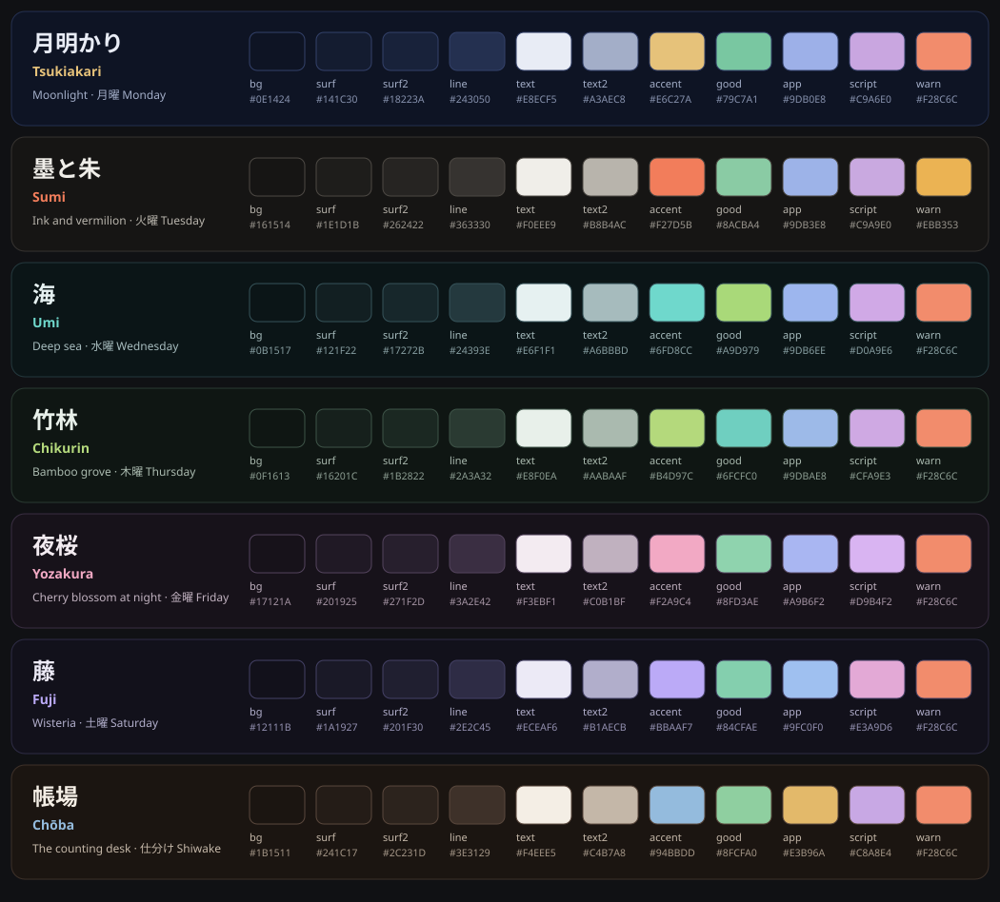

# Colour themes

One set of colours for my apps, slides and documents, so they look like they belong together and not like everything else.

Six themes, each named after a Japanese scene and each tied to a day of the week. Monday to Saturday take the element in the day's name (月 moon, 火 fire, 水 water, 木 wood) or its mood; Sunday rests. Every theme has a dark palette and a light palette.




| Day | Theme | Meaning | Colours | Why this day |
| --- | --- | --- | --- | --- |
| 月 Monday | 月明かり Tsukiakari | Moonlight | Navy and pale gold | 月曜 is the day of the moon |
| 火 Tuesday | 墨と朱 Sumi | Ink and vermilion | Warm charcoal and seal red | 火曜 is the day of fire |
| 水 Wednesday | 海 Umi | Deep sea | Blue-green black and aqua | 水曜 is the day of water |
| 木 Thursday | 竹林 Chikurin | Bamboo grove | Forest black and bamboo green | 木曜 is the day of wood |
| 金 Friday | 夜桜 Yozakura | Cherry blossom at night | Plum black and sakura pink | 花金, the flowery Friday night |
| 土 Saturday | 藤 Fuji | Wisteria | Violet black and wisteria purple | The quiet of the weekend |
| 日 Sunday | (rest) | | | No theme of its own: an app shows the base theme its owner chose |

The Colours column describes the dark palette. The light palette of a theme is the same scene in daylight:

| Theme | Light palette |
| --- | --- |
| 月明かり Tsukiakari | Warm paper, navy ink and deep gold |
| 墨と朱 Sumi | Washi paper, charcoal ink and seal red |
| 海 Umi | Sea-mist paper, deep-sea ink and teal |
| 竹林 Chikurin | Pale leaf paper, forest ink and bamboo green |
| 夜桜 Yozakura | Petal paper, plum ink and deep rose |
| 藤 Fuji | Wisteria-white paper, violet ink and wisteria purple |

## Dark and light

A light palette is not the dark one turned inside out. It is made in three moves:

1. **Ink.** The theme's dark background colour becomes the text.
2. **Paper.** The background is a very pale tint of the theme's hue, with pure white for cards (`surf`).
3. **Accent.** The same hue as the dark accent, made deeper until it can be read on the paper (the pale dark-mode accents are only 1.6:1 to 2.7:1 on white).

The primary button is the accent in dark and the ink in light. The data colours (`good`, `app`, `script`) are deepened in the same way.

## What is here

| Path | What it is |
| --- | --- |
| `themes/tokens.json` | **The source of truth.** Every theme, its names, its weekday and its colours by role, under `dark` and `light`. |
| `themes/themes.css` | The same colours as CSS variables (`--ct-bg`, `--ct-accent`, ...), one block per theme and mode. Made by the build tool. |
| `colour_themes.py` | A small Python helper: `palette("umi")`, `palette("umi", mode="light")`, `theme_for_date(date.today())`. |
| `preview/index.html` | Open in a browser to see every theme, dark and light, on a small app window. |
| `preview/themes.svg`, `preview/themes-light.svg` | The swatch sheets shown above. |
| `icons/tsukiakari/` | The Tsukiakari app icon (moon on water): `icon.svg`, PNG sizes, `icon.ico`, one variant per theme, and the three concepts that were not chosen. |
| `tools/build.py` | Checks the themes and writes the CSS, the previews and the icon SVGs. |
| `tools/render_icons.py` | Makes the PNG files and the `.ico` from `icon.svg` (needs PyQt6). |

## The roles

Every palette has the same role names, so a design made with one theme works with all of them, in dark and in light.

| Role | Use |
| --- | --- |
| `bg`, `side` | The background, and the sidebar a shade darker |
| `surf`, `surf2` | Cards and panels; raised or highlighted panels |
| `line`, `line_strong` | Hairlines; borders of inputs and controls |
| `text`, `text2`, `text3` | Body text; secondary text; labels and hints |
| `accent` | The theme's one accent: links, the active item, key numbers |
| `accent_soft`, `nav_on` | Soft fills: the accent at a low strength, and the fill of the active item |
| `btn`, `btn_ink` | The primary button and the text on it (the accent in dark, the ink in light) |
| `track` | The empty part of a meter |
| `good`, `app`, `script` | Success, and two more colours for charts and labels |

## Using it

**Python (PyQt apps).** Copy `themes/tokens.json` and `colour_themes.py` into the project.

```python
from datetime import date
import colour_themes

palette = colour_themes.palette("yozakura")              # {"bg": "#17121A", ...}
paper = colour_themes.palette("yozakura", mode="light")  # {"bg": "#FBF1F5", ...}
today = colour_themes.theme_for_date(date.today(), base="tsukiakari")
```

**Web pages.** Link `themes/themes.css` and set the theme on any element.

```html
<body data-theme="chikurin" style="background: var(--ct-bg); color: var(--ct-text)">
<body data-theme="chikurin" data-mode="light" style="background: var(--ct-bg); color: var(--ct-text)">
```

**Slides and documents.** Pick one theme and one mode for the whole piece. Use `bg` for the slide, `surf` for cards, `text` for words, and `accent` for the one thing each slide should make you look at. Use `good`, `app` and `script` only for data.

- Dark suits a screen in a dim room. Light suits a bright room, a projector with weak contrast, and anything that will be printed.
- For print and for documents, use the light palette; `surf` (white) can be the page and `bg` the tinted panels.

## Rules

- All text passes a contrast check: 4.5:1 or better for every text colour on the backgrounds it is used on, 7:1 for body text. `tools/build.py` refuses to write anything when a theme fails.
- One accent per theme. A second bright colour is for data only.
- In light palettes, the accent and the data colours are also checked on the sidebar and on white, because they are used as text there.

## Adding or changing a theme

1. Edit `themes/tokens.json`. A new theme needs every role in both `dark` and `light`.
2. Run `python tools/build.py`. Fix what it reports.
3. If the Tsukiakari icon's colours changed, run `python tools/render_icons.py`.
4. Open `preview/index.html` and look at it.
5. Commit everything, the made files included.
